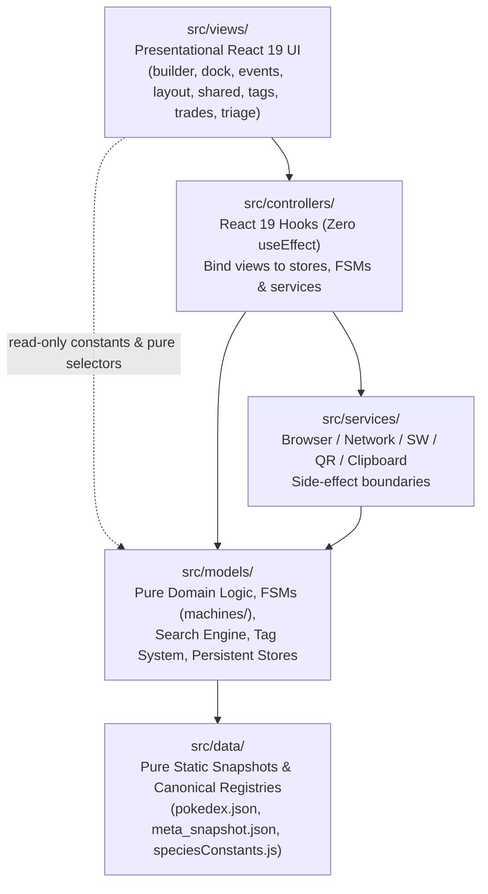

# PokéSearch Architecture Blueprint

This document defines the canonical architecture, data flows, state machines, offline PWA design, and Architectural Decision Records (ADRs) for **PokéSearch (`PokemonGoDexSearchTool`)**.

For day-to-day agent rules and mandatory verification checklists, see [AGENTS.md](../AGENTS.md).

---

## 1. Layered MVC Architecture

PokéSearch uses a strictly acyclic **Model–View–Controller + Services + Data** architecture verified automatically by [src/architecture.test.js](../src/architecture.test.js).

### Layer Responsibilities
- **`src/data/` (Leaf layer — zero imports)**
  - `pokedex.json`: Generated by `scripts/fetch_data.js` (`npm run update:data`). Source of truth for species, types, `familyDexes`, `evolveCandy`, and max Dex ID.
  - `meta_snapshot.json` & `meta_cache.json`: Generated by `scripts/fetch_meta.js` (`npm run update:meta`). PvP Top 100 (GL/UL/ML), PvE Top 30 / per-type / Shadows / Megas, Max Battles, and 500ms fast moves.
  - `events_archive.json`: Curated global/in-person Pokémon GO events.
  - `speciesConstants.js`: Single canonical source of truth for regions (`REGIONS_CONFIG`), starters, scarce/regional IDs (`SCARCE_RARE_SPECIES_IDS`), 12-candy fodder, trade-evolves, `CLASSIC_GL_XL_FLOOR_IDS`, `CLASSIC_PVE_TYPE_SHADOW_IDS`, `DEFAULT_FAST_MOVES_500MS`, and `formatMoveDisplayName`.
  - `communityDayRegistry.js`: Pure Community Day metadata (`RAW_COMMUNITY_DAYS`); `familyIds` and `preEvoIds` are derived dynamically in `communityDayModel.js` from `pokedex.json`.
  - `travelTripsData.js`: Optional sample trips (not injected into user storage unless explicitly imported).
- **`src/models/` (Pure JS — zero React, zero DOM side effects outside `storage/`)**
  - **Search Engine (`src/models/search/` + `searchEngine.js` facade)**:
    - `operatorRegistry.js`: Declarative operator registry (single edit point for new PoGO keywords).
    - `idRanges.js`: Compressed Dex ID range encoding/decoding and De Morgan negations.
    - `queryBuilder.js`: Bidirectional `generateSearchString` and `parseSearchString` (including `@1`/`@2` moves, `@special`, `@weather`, `@3mov`, IV/CP/HP/age/year/buddy/candyxl ranges).
    - `validator.js`: `validateSearchString` domain linter (flags broken IV negations, `!mega` traps, unscoped `!maxmove2-`, inverted `@3mov` in trash strings, unknown operators, >4000-char limits).
    - `cnfCompiler.js`: `compileDnfToPogoCnfSafe` (bounded DNF→CNF distribution with sorted superset absorption, tautology removal, contradiction pruning, and hard `maxClauses`/`maxChars` guardrails).
  - **Tag System (`src/models/tags/` + `tagModel.js` facade)**:
    - `tagDefinitions.js`: 30-tag taxonomy across 7 namespaces (`ev`, `keep`, `pvp`, `pve`, `max`, `tr`, `op`) + 6-stage hydration order.
    - `tagLinter.js`: Native keyword collision detection, prefix-collision checking, and custom tag map merging.
    - `tagHydration.js`: Data-driven `HYDRATION_BUILDERS` registry producing validated queries for all tags (including Top-100 league rosters & `@3mov,evolve` build audits).
  - **Trade & Anti-Hoarding Models (`src/models/trades/`)**:
    - `tradeValueModel.js`: Curated Trade Demand Tiers (S/A/B), Dead Trade Tag Audits, Duplicate Cap Pruner, Stale Hoard Cleanup (`buildSafeTrashQuery`), and 2026 Forever Friends Remote Trade (`age30-`) showcase queries.
    - `tradeWishlistModel.js`: Offline personal Wishlist compiler (Fly33-style exclusion-filter algebra) + persistent store (`pogo_trade_wishlists_v1`) + multi-friend Group Wants Merger & Unwanted Surplus cleanup.
  - **Domain Models**: `triageFunnelModel.js`, `eventArchiveModel.js`, `metaCacheModel.js`, `communityDayModel.js`, `familyModel.js`, `pokedexModel.js`, `savedSearchModel.js`, `filterPresets.js`, `spriteUrls.js`, `pwaModel.js`.
  - **Persistent Store Primitive (`src/models/storage/createPersistentStore.js`)**: `useSyncExternalStore`-compatible store factory with `localStorage` persistence, cross-tab `storage` sync, `localStorage.clear()` (`event.key === null`) recovery, `QuotaExceededError` notification (never silent green saves), and schema validation hooks.
- **`src/services/` (Imperative browser/network boundaries — zero React)**
  - `copyService.js`: Global Invoker Commands listener (`command="--copy"` + `commandfor`) with iOS `<dialog>`-safe clipboard fallback and `SearchStringDock` sync (`data-sync-dock="false"` opt-out).
  - `pwaService.js`: Workbox registration (`virtual:pwa-register`), `online`/`visibilitychange` update checks, and safe `applyPwaUpdate` timeout recovery.
  - `metaNetworkService.js`: Parallel `Promise.all` live PvPoke fetch (`gamemaster` + GL/UL/ML rankings).
  - `qrCodeService.js`: Local bundled `qrcode` data-URL generation (100% offline).
  - `fileTransferService.js`: JSON export/import helpers with delayed `URL.revokeObjectURL` for iOS Safari.
- **`src/controllers/` (React 19 hooks — zero `useEffect`/`useLayoutEffect`)**
  - Root/tab controllers: `useWorkspaceController`, `useSearchDockController`, `useSavedSearchesController`, `usePokedexBuilderController`, `useTagSystemController`, `useTriageFunnelsController`, `useEventsHubController`, `useTradesHubController`, `usePwaController`.
  - Isolated per-panel Events Hub controllers (`src/controllers/events/`): `useEventsArchiveController`, `useYearSlicerController`, `useCommunityDaysController`, `useMetaExplorerController`, `useCnfCombinerController`.
  - Isolated per-panel Trades Hub controllers (`src/controllers/trades/`): `useTradeAuditController`, `useRemoteTradeController`, `useTradeWishlistController`.
- **`src/views/` (Presentational React 19 components)**
  - Feature-grouped (`builder/`, `dock/`, `events/`, `layout/`, `shared/`, `tags/`, `trades/`, `triage/`), wrapped in `<ErrorBoundary>`, with `React.lazy` splitting on non-default workspace tabs.

---

## 2. Explicit Finite State Machines (`src/models/machines/`)

| Machine | States / Responsibilities |
| --- | --- |
| `workspaceMachine.js` | Active workspace tab (`triage`, `events`, `tags`, `trades`, `builder`) & URL/storage persistence |
| `searchDockMachine.js` | Dock draft editing, validation feedback, saved-search drawer, QR modal lifecycle |
| `triStateMachine.js` | Deterministic `neutral -> include -> exclude -> neutral` filter chip transitions |
| `resetConfirmMachine.js` | Two-step destructive confirmation (`idle -> armed -> idle`) |
| `metaSyncMachine.js` | Live PvPoke sync (`idle -> syncing -> success | error`) with status messaging |
| `eventModalMachine.js` | Event create/edit/delete dialog state with explicit payload transitions |
| `qrModalMachine.js` | Async offline QR `<dialog>` lifecycle (`idle -> loading -> ready | error`) with monotonic `requestId` guard |
| `pwaMachine.js` | Service worker lifecycle (`idle -> offlineReady | updateAvailable -> updating -> error`) |

---

## 3. Persistent Storage Keys (`localStorage`)

All keys are owned by dedicated stores created with `createPersistentStore`:
- `pokedex_viewMode`
- `pokedex_selectedIds`
- `pokedex_filters`
- `pokedex_saved_searches`
- `pokedex_custom_tags`
- `pogo_tag_hydration_checked_v1`
- `pogo_stored_event_db_v2`
- `pogo_personal_travel_trips_v1`
- `pogo_live_meta_cache_v1`
- `pogo_trade_wishlists_v1`

---

## 4. Offline-First PWA & Caching Strategy

Configured in [vite.config.js](../vite.config.js) (`vite-plugin-pwa` in `devDependencies`):
- **App Shell & Data**: Precached via Workbox `generateSW` (`registerType: 'prompt'`, `injectRegister: false`, `cleanupOutdatedCaches: true`), with manual Rollup chunks (`data-pokedex`, `data-meta`, `data-events`) so non-active tabs load lazily.
- **Pokémon Sprites**: `CacheFirst` (`pokemon-sprites`, `maxEntries: 3000`, 30 days) with **`statuses: [200]`** paired with `` in `PokemonSprite.jsx`. Never cache opaque `status: 0` responses (each padded to ~7 MB in Chromium/iOS quota accounting and masks 5xx/captive-portal errors).
- **Live PvPoke Sync**: **`NetworkOnly`** so explicit **Sync Live** clicks never falsely report cached data as fresh; offline fallback is served explicitly from `metaCacheModel`.
- **Zero CDN Runtime Imports**: All runtime libraries (`qrcode`, React, etc.) are bundled via npm/Vite so every feature works in airplane mode.

---

## 5. Architectural Decision Records (ADRs)

- **ADR-001 — Zero `useEffect` / `useLayoutEffect`**: Enforced via ESLint `no-restricted-imports` and `src/architecture.test.js`. Eliminates stale closures, double-mount hazards, and hidden effect chains in favor of `useSyncExternalStore`, React 19 ref cleanup callbacks, and synchronous event handlers.
- **ADR-002 — Declarative Operator Registry (`operatorRegistry.js`)**: Adding a new Pokémon GO search keyword requires one entry instead of touching 7+ files across query generation, parsing, filter counting, tag linting, and UI chips.
- **ADR-003 — Unified `buildSafeTrashQuery` & Read-Only Dock Diagnostics**: Destructive transfer strings share a single shield builder with explicit opt-outs only for the targeted trait, verified by `validateSearchString` and `triageSimulator.test.js`. The search dock never silently auto-rewrites valid CNF strings.
- **ADR-004 — Dynamic Data Derivation (Zero 1025 / 2026 Cliffs)**: Evolution families (`familyModel.js`), Community Day pre-evolutions (`evolveCandy` in `pokedex.json`), max Dex IDs, and event year selectors derive dynamically from data snapshots rather than hardcoded constants.
- **ADR-005 — Isolated Per-Panel Controllers for `hidden="until-found"`**: `EventsHubView` and `TradesHubView` keep all sub-panels discoverable by browser Find-in-Page while avoiding cross-panel re-renders by giving each panel its own controller under `src/controllers/events/` and `src/controllers/trades/`.
- **ADR-006 — CORS-Safe Workbox Sprite Caching & `NetworkOnly` Live Sync**: Prevents iOS/Android quota eviction from opaque sprite responses and guarantees truthful live-sync status during crowded live events.
